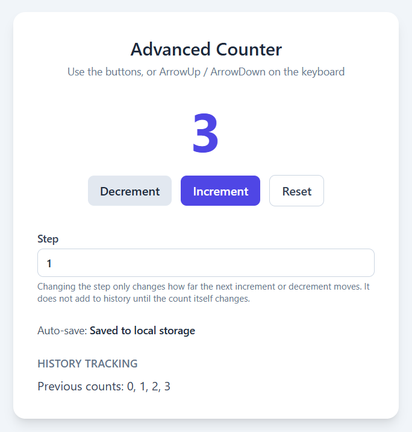

# Advanced Counter

A React counter on a pale slate page. Increment and Decrement move the count by the current step. The history lists every count. After a short wait, the count, step, and history are saved in the browser under the key `advanced-counter-state`.

On a first visit the count is 0, the step is 1, and the history is `0`. The status starts as **Saving...** and changes to **Saved to local storage** about 400ms later. Another change before that wait finishes cancels the pending save and starts a new one.

## Screenshots

**Start.** Count 0, step 1, history `0`, already saved.


**Three increments.** Each click adds 1. The history is `0, 1, 2, 3`.



**Step of 5.** Changing the step does not add a history entry. The next Increment jumps from 3 to 8, so the history is `0, 1, 2, 3, 8`.


## How it behaves

- Decrement subtracts the step. Increment adds it. The count can go below zero.
- Reset sets the count and the history back to `0`. It leaves the step as it is.
- ArrowUp and ArrowDown do the same as Increment and Decrement. While the step field is focused, those keys stay in the field and do not change the count.
- The saved value is JSON with `count`, `step`, and `history`. A later visit restores that snapshot. If the stored value is missing or not valid, the counter starts at 0 again.

## Getting started

```bash
npm install
npm run dev
```

Vite serves the app at `http://localhost:5173/`.
